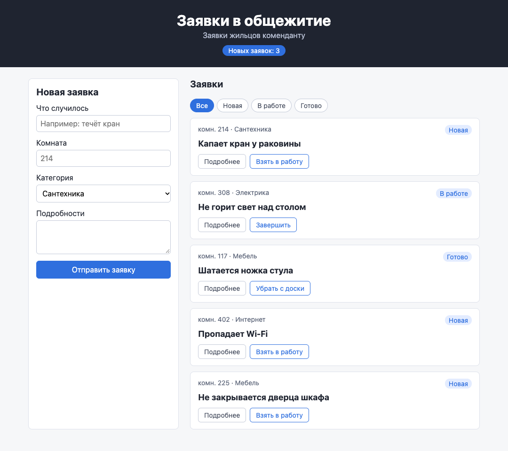

# Заявки в общежитие

Вариант проекта модуля 1 — «Общежитие». Жилец сообщает коменданту, что сломалось и в какой комнате. На доске видно, какие обращения ещё ждут мастера.



## Что реализовано

| Требование | Как проверить |
|---|---|
| Шапка и счётчик новых заявок | При первом открытии на доске пять карточек с разными ID и тремя статусами. В шапке указаны три новые заявки. |
| Форма с четырьмя категориями | Укажите тему и комнату. Выберите сантехнику, электрику, мебель или интернет. Отправка пустых полей или одних пробелов показывает подсказку. |
| Добавление и подробности | Новая карточка появляется первой, форма очищается. Кнопка «Подробнее» раскрывает описание, «Скрыть» сворачивает его. |
| Список, статусы и фильтры | Карточки выводятся через `map` с `key={r.id}`. Нажмите «Взять в работу», затем «Завершить». Готовую заявку можно убрать. Когда выбранному статусу ничего не соответствует, доска показывает сообщение. |
| Сохранение | Обновите страницу. Заявка и её статус сохраняются под ключом `zayavki-obshchezhitie`. |
| Уведомление | При создании карточки доска отправляет заявку на вебхук n8n и показывает результат запроса. При недоступном вебхуке заявка остаётся в списке. |

Выполнены обязательные функции доски. Из дополнительных заданий в проект ничего не включено.

## Запуск и проверка

Из `React/projects/p1-obshchezhitie` под Node.js 24 выполните:

```bash
npm ci
npm run build
npm run lint
npm run dev
```

Откройте `http://localhost:5173`. Для проверки уведомления сначала запустите n8n по инструкции. Снимок реального сообщения предстоит приложить после подключения учебного бота.

[Задание и критерии](https://maximbytecamp.github.io/angular_react_makarov/temy/19-proekt-doska-zayavok/index.html) · [Основа после главы 1.7](https://github.com/Ilpaka/TDSDB/tree/6f65b101da85ce37aa1bb6c3b2ecdde0ece5da68/React/zayavki) · [Автоматизация](../../avtomatizaciya/README.md) · [Журнал работы с ИИ](ai-log.md).
