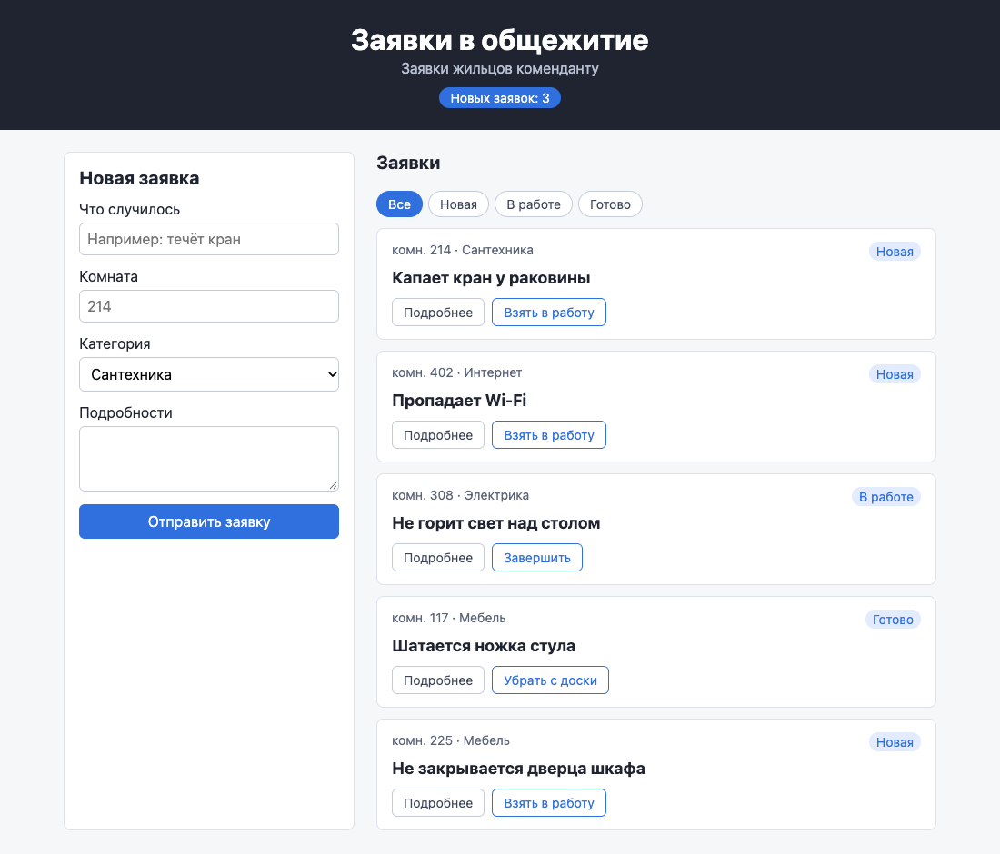
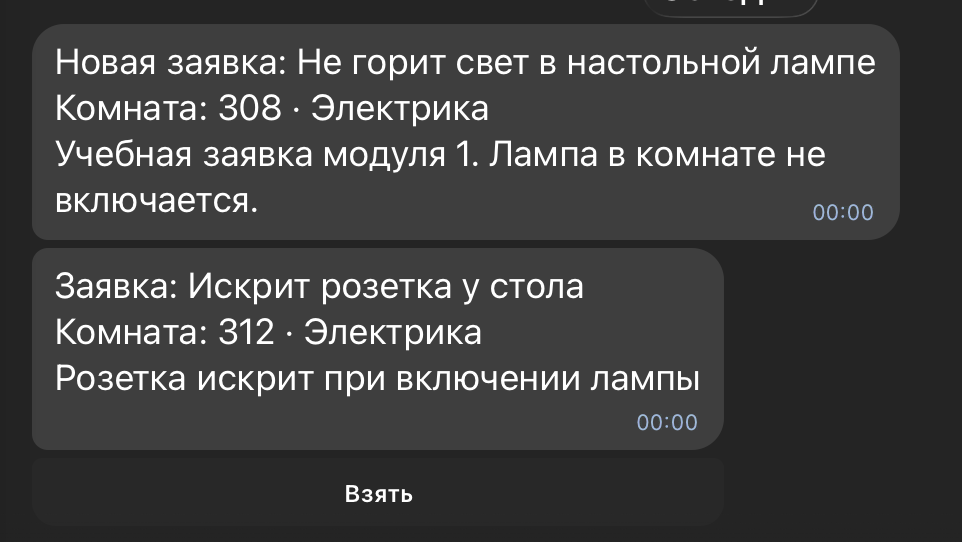
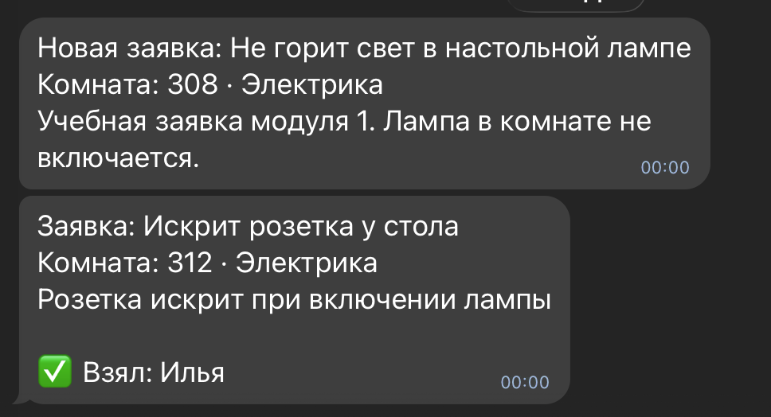

# Заявки в общежитие с общей базой

Проект модуля 2. Жильцы отправляют заявки из браузера, комендант видит их в общей очереди. Когда мастер берёт заявку через Telegram, статус меняется и у жильца, и у коменданта.



## Запуск доски

Из корня репозитория запустите PocketBase. При первом старте база сама создаст коллекцию `obshchezhitie` и заполнит её пятью заявками из проекта 1. Данные хранятся в томе `pb_data`.

```bash
cd React/avtomatizaciya
docker compose up -d --build pocketbase
cd ../projects/p2-obshchezhitie
npm ci
npm run dev
```

Откройте `http://localhost:5173` в двух окнах браузера. По очереди создайте заявку, нажмите «Взять в работу», «Завершить» и «Убрать с доски». Изменения должны появиться во втором окне по одному разу. После перезагрузки данные берутся из PocketBase. Для проверки сборки под Node.js 24 выполните `npm run build` и `npm run lint`.

## Что проверять

| Часть проекта | Результат |
|---|---|
| Форма и карточки | Поля темы, комнаты, категории и подробностей. Четыре категории — сантехника, электрика, мебель и интернет. Есть счётчик новых заявок, фильтры и раскрытие подробностей. |
| Правила коллекции | Читать могут все. Создать можно только «Новую». После создания разрешено менять категорию и статус. Тема, комната и описание защищены. Удалять можно только «Готово». |
| Получение данных | Пока сервер отвечает, видна надпись «Загрузка заявок…». При ошибке появляется кнопка «Повторить». Черновик сохраняется в форме, если сервер отклонил создание заявки. |
| Синхронизация | Хук `useRequests` подписывается на события коллекции и загружает записи. События, пришедшие во время загрузки, применяются к списку. Повторное появление записи с тем же ID обновляет карточку. |
| ИИ-диспетчер | Получает тему и подробности, выбирает категорию и срочность, записывает категорию в PocketBase и готовит сообщение с кнопкой «Взять». |
| Кнопка мастера | n8n опрашивает Telegram каждые 10 секунд. Нажатие меняет статус в базе на «В работе». Бот отвечает мастеру и подписывает исходное сообщение его именем. |

Чтобы проверить восстановление после сбоя, в папке `React/avtomatizaciya` выполните `docker compose stop pocketbase` и обновите страницу. Запустите базу командой `docker compose start pocketbase` и нажмите «Повторить».

## Результат проверки

Проверка в двух окнах прошла на запущенном PocketBase. Новая карточка появилась по одному разу, смена статуса и удаление отразились в обоих окнах. После остановки и запуска сервера кнопка «Повторить» восстановила список.

В полном прогоне Qwen изменила ошибочную категорию «Мебель» у заявки об искрящей розетке на «Электрика» и отметила заявку как срочную. n8n записал категорию и сформировал сообщение с кнопкой. Локальный имитатор Telegram принял сообщение и вернул нажатие. n8n изменил сообщение, а открытая доска показала «В работе». 20 ноября 2026 года проверка пройдена с учебным ботом. Через форму отправили заявку «Искрит розетка у стола», комната 312, с исходной категорией «Мебель». Модель исправила категорию на «Электрика». Получатель нажал «Взять», Telegram показал подпись мастера, а PocketBase вернул для этой же заявки статус «В работе».





## Подключение ИИ-диспетчера

1. В `React/avtomatizaciya` выполните `docker compose up -d --build`, затем `docker compose exec ollama ollama pull qwen2.5:3b`. После загрузки модель работает локально. Если она уже есть в выводе `docker compose exec ollama ollama list`, повторная загрузка не нужна.
2. Для настоящего бота укажите токен в локальном `React/avtomatizaciya/.env` после `TELEGRAM_BOT_TOKEN=`. Образец — `.env.example`. После изменения токена выполните `docker compose up -d n8n` и нажмите **Start** в личном чате с ботом.
3. Откройте `http://localhost:5678`. Импортируйте [ИИ-диспетчер](n8n/ii-dispetcher.json) и [Кнопка «Взять»](n8n/knopka-vzyat.json) через **Import from File**. В узлах Telegram выберите учётные данные типа **Telegram API**. В узле **Telegram** первого процесса заполните **Chat ID** в редакторе. В файле для сдачи поле пустое.
4. Опубликуйте оба процесса. Вебхук этого проекта — `/webhook/zayavka-obshchezhitie`. Для одного бота оставьте опубликованным один процесс опроса нажатий.
5. Создайте заявку «Искрит розетка у стола» и по ошибке укажите «Мебель». Проверьте, как меняется категория. Нажмите «Взять» в сообщении и проследите за статусом карточки во втором окне.

Схема базы, начальные записи и правила находятся в [миграции PocketBase](../../avtomatizaciya/pocketbase/pb_migrations/1795046400_request_boards.js). [Задание преподавателя](https://maximbytecamp.github.io/angular_react_makarov/temy/29-proekt-doska-s-bazoy/index.html) · [Автоматизация и запасной способ загрузки модели](https://maximbytecamp.github.io/angular_react_makarov/temy/28-ii-dispetcher/index.html) · [Журнал работы с ИИ](ai-log.md).
