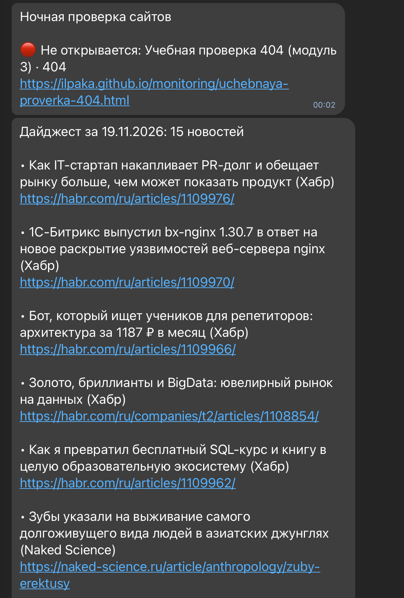

# Мониторинг сайтов группы

Проект модуля 3 по дисциплине «Angular и React». Монитор показывает, какие сайты открываются сейчас и как менялась их доступность за последние 30 проверок.

| Что открыть | Ссылка |
|---|---|
| Опубликованная сводка | [Мониторинг сайтов на GitHub Pages](https://ilpaka.github.io/monitoring/) |
| Код, команды запуска и настройки | [Ilpaka/monitoring](https://github.com/Ilpaka/monitoring) |
| Страница отдельного сайта | [История ChromaSync](https://ilpaka.github.io/monitoring/site/chromasync) |
| Результат запуска | [Ночная проверка, коммит бота и публикация](https://github.com/Ilpaka/monitoring/actions/runs/44630757011) |
| Работа с ИИ | [Журнал проекта](ai-log.md) |

## Что выполнено

- **Сводка и история.** Сводка показывает число недоступных сайтов. На странице сайта видны его адрес, количество успешных проверок, время, код HTTP и длительность каждого ответа. Строки с ошибками выделены.
- **Маршруты.** Работают главная, `/site/:id`, `/about` и страница для неизвестного адреса. Переходы в шапке сделаны через `NavLink`. Проверены открытие страницы сайта в новой вкладке, обновление по F5 и возврат на сводку со страницы неизвестного сайта.
- **Контекст.** Провайдер загружает `sites.json` и `results.json`, а шапка и страницы читают их через `useMonitoring`. При загрузке появляется сообщение ожидания. При недоступности файла интерфейс показывает имя файла и код ответа. В браузере проверена ошибка HTTP 503.
- **Автоматизация.** Проверка запланирована на 00:00 МСК. Вручную запущен тот же процесс GitHub Actions: он опросил сайты, сохранил результаты коммитом бота и заново опубликовал Pages. При первом запуске все пять страниц вернули HTTP 200.
- **Оповещения.** Скрипт сравнивает текущую и предыдущую проверки. Сценарий «работает → сбой → повторный сбой → восстановление» в локальной проверке дал два сообщения тестовому получателю. 20 ноября 2026 года скрипт проверки получил HTTP 404 от отдельного учебного адреса GitHub Pages и отправил оповещение в личный Telegram-чат. Проверка шла локально со временным списком адресов. Для ночного процесса настроены закрытые параметры GitHub Actions `TELEGRAM_TOKEN` и `TELEGRAM_CHAT_ID`. При ручном запуске 20 ноября все пять учебных страниц ответили HTTP 200, шаг оповещения завершился успешно. [Запуск ночного процесса](https://github.com/Ilpaka/monitoring/actions/runs/44615259514).
- **Сборка.** `npm ci`, `npm run build` и `npm run lint` выполнены. Сборка и линтер также запускаются при публикации.

## Сайты группы

20 ноября пять временных страниц заменены сайтами трёх одногруппников. Измеряются два монитора, LeBron James Ventures, ChromaSync и сайт футбольной секции «Высота». Каждому адресу присвоен новый ID. При первом опросе все пять ответили HTTP 200. Те же пять адресов проверил GitHub Actions. [Список адресов](https://github.com/Ilpaka/monitoring/blob/main/public/data/sites.json).

Выполнена обязательная часть приложения и автоматизации. Дополнительные задания по выбору в проект не включены.

[Критерии проекта](https://maximbytecamp.github.io/angular_react_makarov/temy/39-proekt-monitoring/index.html) · [Условия автоматизации](https://maximbytecamp.github.io/angular_react_makarov/temy/38-opoveshchenie/index.html).
